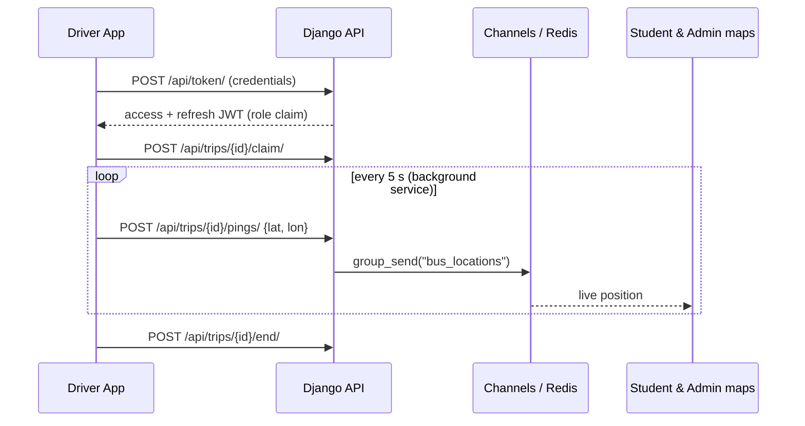

# Bus Driver App — GPS Streaming Client (React Native)

> The Android/iOS app that drivers use in the **[Real-Time College Bus Tracking Platform](https://github.com/karrisubhash/bus_tracker)**. The driver signs in, claims a trip, and the app streams GPS to the backend every 5 seconds from a background service, so tracking keeps running while the phone is locked.

[](#)
[](#)
[](https://github.com/karrisubhash/bus_tracker)

**Backend (live):** https://college-bus-tracking-system-ri73.onrender.com · **Demo video:** https://youtu.be/i2Xq8YOuVXY

## Features

- JWT sign-in against the Django backend (`/api/token/`).
- Enter a trip ID and claim it with `POST /api/trips/{id}/claim/`.
- **Background tracking** with `react-native-background-actions`: a loop that reads a high-accuracy fix (`react-native-geolocation-service`) and posts `{lat, lon}` every 5 s.
- Tolerates network drops: a failed post is logged and retried on the next cycle without stopping tracking.
- Ends the trip, and reports or resolves a breakdown from the app (`/end/`, `/report-issue/`, `/resolve-issue/`).

## How it fits together



## Tech stack

React Native 0.73 · TypeScript · axios · react-native-geolocation-service · react-native-background-actions

## Getting started

Prerequisites: the [React Native environment setup](https://reactnative.dev/docs/set-up-your-environment) (Node 18+, JDK 17, Android Studio).

```bash
git clone https://github.com/karrisubhash/Bus-Driver-Application.git
cd Bus-Driver-Application
npm install
npm start            # Metro
npm run android      # in a second terminal
```

The backend URL is set in `App.tsx` (`BASE_URL`). Point it at your own deployment or at `http://10.0.2.2:8000` for a local backend on the Android emulator.

### Permissions

Android needs `ACCESS_FINE_LOCATION`, `ACCESS_BACKGROUND_LOCATION` and `FOREGROUND_SERVICE` for background tracking.

## Project structure

```
App.tsx          # login, trip claim, background tracking loop, issue reporting
android/  ios/   # native projects
__tests__/       # Jest smoke test
```

## Testing

```bash
npm test
```

## Screenshots

<!-- TODO(Subhash): add 2 phone screenshots (login, tracking screen) -->

## Future improvements

- Move `BASE_URL` into build config (`react-native-config`).
- Persist the session securely (Keychain/Keystore) and refresh the JWT automatically. The token currently lives in component state only.
- Remove the unused dependencies (`async-storage`, `netinfo`, `native-stack`) or wire them in.
- Queue pings offline and send them in batches when the connection returns.
- Split `App.tsx` into screens and services.
