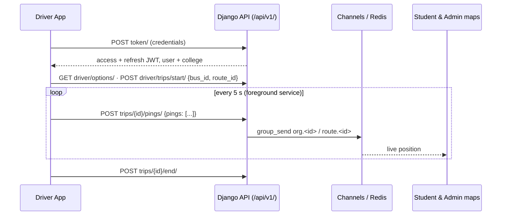

# Bus Driver App — GPS Streaming Client (React Native)

> The Android app drivers use in the **[Real-Time College Bus Tracking Platform](https://github.com/karrisubhash/bus_tracker)**.
> The driver signs in once, starts a trip by picking a bus and route, and a foreground service
> streams GPS to the backend every 5 seconds. Tracking keeps running with the phone locked or
> offline.

[](#)
[](#)
[](https://github.com/karrisubhash/bus_tracker)

**Backend (live):** https://college-bus-tracking-system-ri73.onrender.com · **Demo video:** https://youtu.be/i2Xq8YOuVXY

## Features

- **Sign in once.** The session is persisted and the access token is refreshed automatically
  (rotating refresh tokens, `/api/v1/token/refresh/`).
- **Start a trip in one tap.** The home screen offers:
  - resume an ongoing trip;
  - start a trip the transport office scheduled;
  - start a new one by picking **bus** and **route**. The last choice is remembered and buses
    already on a trip are disabled.
- **Background tracking** via a foreground service (`react-native-background-actions`, type
  `location`) with `watchPosition`. Fixes upload in batches every 5 s, and the screen can be off.
- **Offline-proof.** With no network, fixes are queued on the phone (up to 1000) and uploaded with
  their original timestamps when the connection returns. A parked bus re-sends its last fix so it
  stays "live".
- **Issues.** Report one (breakdown, delay, accident, other), mark it resolved, or end the trip.
- **Server-aware.** If the office ends or reassigns the trip, tracking stops on the phone and the
  driver sees why.

## How it fits together



## Tech stack

React Native 0.73 · TypeScript · axios · AsyncStorage · NetInfo ·
react-native-geolocation-service · react-native-background-actions

## Project structure

```
App.tsx                 screen switching + session restore
src/config.ts           server URL and tracking tunables  <- edit per deployment
src/api.ts              axios client, token refresh, endpoints
src/tracking.ts         background GPS + upload queue
src/storage.ts          AsyncStorage (session, active trip, offline queue)
src/permissions.ts      location / notification permission flow
src/screens/            LoginScreen, HomeScreen, TripScreen
__tests__/              Jest tests (app render + tracking logic)
```

## Configuration

Edit `src/config.ts`:

| Setting | Default | Notes |
|---|---|---|
| `API_BASE_URL` | `https://college-bus-tracking-system-ri73.onrender.com` | Server root, **https only** in release builds |
| `PING_INTERVAL_MS` | `5000` | Upload interval while a trip runs |
| `MAX_QUEUED_PINGS` | `1000` | Offline queue cap |

For a white-label build per customer, change four things:

- `API_BASE_URL` / `APP_NAME` in `src/config.ts`;
- the app name in `android/app/src/main/res/values/strings.xml`;
- `versionCode` / `versionName` in `android/app/build.gradle`.

## Getting started

Prerequisites: the [React Native environment setup](https://reactnative.dev/docs/set-up-your-environment)
(Node 18+, JDK 17, Android Studio).

```bash
git clone https://github.com/karrisubhash/Bus-Driver-Application.git
cd Bus-Driver-Application
npm install
npm start            # Metro
npm run android      # debug build on a device/emulator (second terminal)
npm test             # jest
npx tsc --noEmit     # type check
npm run lint
```

Debug builds allow plain `http://`, for Metro and a local backend (e.g. `http://10.0.2.2:8000`
from the emulator). Release builds only allow `https://`.

## Building a signed release (Play Store / direct APK)

1. Create an upload keystore once and keep it safe. If you lose it, you can't update the app.

   ```bash
   keytool -genkeypair -v -storetype PKCS12 -keystore bus-driver-upload.keystore \
     -alias bus-driver -keyalg RSA -keysize 2048 -validity 10000
   ```

2. Move it to `android/app/` (git ignores it there). Then add these lines to
   `~/.gradle/gradle.properties`, your user Gradle file, **not** the project's:

   ```properties
   MYAPP_UPLOAD_STORE_FILE=bus-driver-upload.keystore
   MYAPP_UPLOAD_STORE_PASSWORD=********
   MYAPP_UPLOAD_KEY_ALIAS=bus-driver
   MYAPP_UPLOAD_KEY_PASSWORD=********
   ```

3. Build:

   ```bash
   cd android
   ./gradlew bundleRelease     # app-release.aab for the Play Store
   ./gradlew assembleRelease   # app-release.apk for direct install / MDM
   ```

   Output: `android/app/build/outputs/bundle/release/` or `.../apk/release/`.

If the `MYAPP_UPLOAD_*` properties are missing, the release build falls back to the debug key and
Gradle prints a warning. **Never distribute a debug-signed build.**

## Permissions and why

| Permission | Why |
|---|---|
| `ACCESS_FINE_LOCATION` | Precise bus position while a trip is running |
| `FOREGROUND_SERVICE` / `FOREGROUND_SERVICE_LOCATION` | Keep tracking with the screen off (Android 14 requires the typed permission) |
| `POST_NOTIFICATIONS` (Android 13+) | Show the "Trip in progress" notification; tracking still works if denied |
| `WAKE_LOCK`, `INTERNET` | Upload while the phone sleeps |

Background ("Allow all the time") location is **deliberately not requested**. The `location`
foreground service starts while the app is open, so Android treats it as while-in-use access. That
avoids Google Play's background-location declaration and review.

Play Console still requires two things:

- the **foreground service type declaration** (location: "Live bus tracking for students during a
  trip");
- a **privacy policy** URL describing location collection.

## Known limitations / next steps

- **Play Store target API.** The project targets SDK 33 (React Native 0.73). Google Play requires
  new apps and updates to target **API 35 or newer**, which needs a React Native upgrade (0.76+)
  and then re-testing the background service and geolocation libraries. Direct APK / MDM
  distribution is unaffected.
- **iOS.** Background location isn't configured (Info.plist usage strings, background modes).
  iPhone drivers can use the web driver page (`/driver/`) on the server with the screen kept on.
- **Battery optimisation.** Some phone makers (Xiaomi, Oppo, Vivo, Samsung) kill foreground
  services aggressively. Ask drivers to set the app's battery usage to "Unrestricted".
- **Unused dependency.** `@react-navigation/native-stack` is no longer imported and can be removed.
